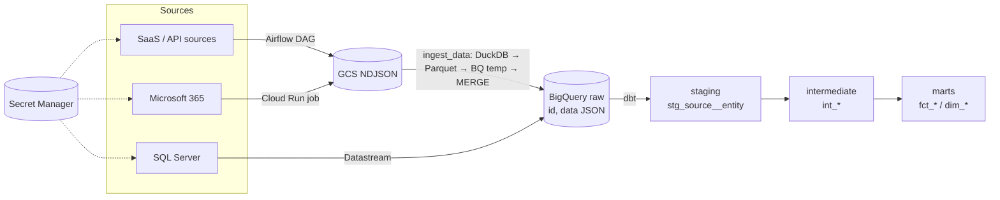

# data-platform-template

An open-source template for a data platform on GCP (London, `europe-west2`): Terraform, Airflow, dbt and Cloud Run.

## Architecture



## Layout

| Path | Purpose |
| --- | --- |
| `terraform/modules/` | Reusable modules: project, bigquery, gcs, secrets, airflow, datastream, cloud-run-job, iam |
| `terraform/envs/` | One env per deployment (`example/` is the template) |
| `airflow/` | DAGs (one per source + `dbt_build`), shared `ingest_data` package in `dags/`, managed with uv |
| `dbt/` | SQL-only dbt v2 (Fusion) project: staging, intermediate, marts, seeds |
| `cloud-run/jobs/<name>/index.ts` | Bun + TypeScript jobs, only where parallelism is needed; `cloud-run/build.ts` builds the images |
| `.github/workflows/` | CI |
| `docs/` | Architecture, connectors, security |

## Quickstart

```bash
# Infrastructure
cd terraform/envs/example
cp example.tfvars <name>.tfvars   # set project_id, enabled_sources
terraform init && terraform plan -var-file=<name>.tfvars

# dbt v2 (see dbt/README.md for install)
cd dbt
dbt parse --profiles-dir .

# Airflow dependencies
cd airflow
uv sync

# Cloud Run job images
cd cloud-run
bun install && bun run build
```

## Conventions

- One source = one connector unit: a DAG (or Cloud Run job), a dbt staging folder, sources YAML and a docs page.
- Every source lands as `(id, data JSON)` via `ingest_data`; typing happens in staging.
- SQL Server sources use Datastream (Terraform), not DAGs.
- Secrets live only in Secret Manager and are referenced by name; never committed.

See [`docs/`](docs/) and [`AGENTS.md`](AGENTS.md) for more.
