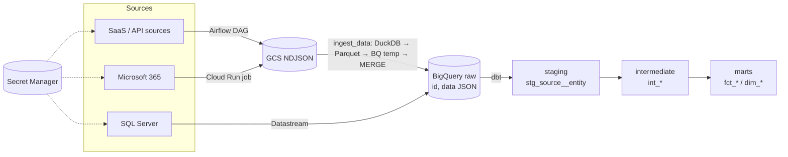

# data-platform-template

An open-source template for a client data platform on GCP (London, `europe-west2`). Each client build copies this layout into its own private repo and deploys to its own GCP project.

## Architecture



## Layout

| Path | Purpose |
| --- | --- |
| `terraform/modules/` | Reusable modules: project, bigquery, gcs, secrets, airflow, datastream, cloud-run-job, iam |
| `terraform/envs/` | One env per firm (`example/` is the template) |
| `airflow/` | DAGs (one per source + `dbt_build`), shared `ingest_data` task group, tests, local `docker-compose.yml` |
| `dbt/` | SQL-only dbt project: staging, intermediate, marts, CI seeds |
| `cloud-run/jobs/<name>/` | Bun + TypeScript jobs, only where parallelism is needed |
| `.github/workflows/` | CI |
| `docs/` | Architecture, onboarding a firm, connectors, security |

## Quickstart

```bash
# Infrastructure
cd terraform/envs/example
cp example.tfvars <firm>.tfvars   # set project_id, enabled_sources
terraform init && terraform plan -var-file=<firm>.tfvars

# dbt (CI target uses DuckDB and the seeds)
cd dbt
pip install -r requirements.txt
DBT_TARGET=ci DBT_PROFILES_DIR=. dbt build

# Airflow locally
cd airflow
docker compose up airflow-init && docker compose up
```

## Conventions

- One source = one connector unit: a DAG (or Cloud Run job), a dbt staging folder, sources YAML and a docs page.
- Every source lands as `(id, data JSON)` via `ingest_data`; typing happens in staging.
- SQL Server sources use Datastream (Terraform), not DAGs.
- Secrets live only in Secret Manager and are referenced by name; never committed.

See [`docs/`](docs/) and [`AGENTS.md`](AGENTS.md) for more.
